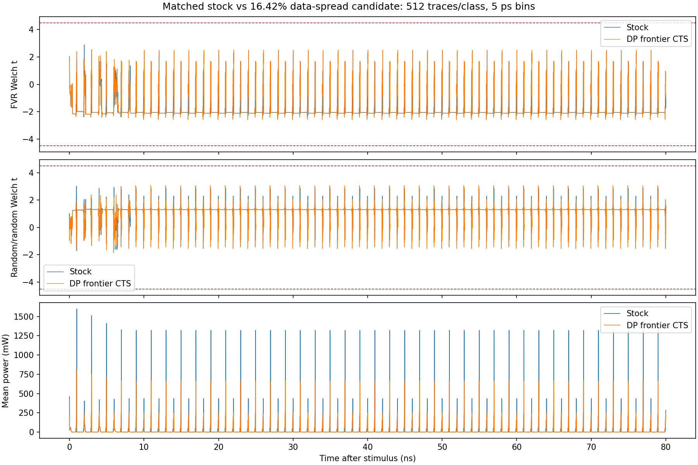
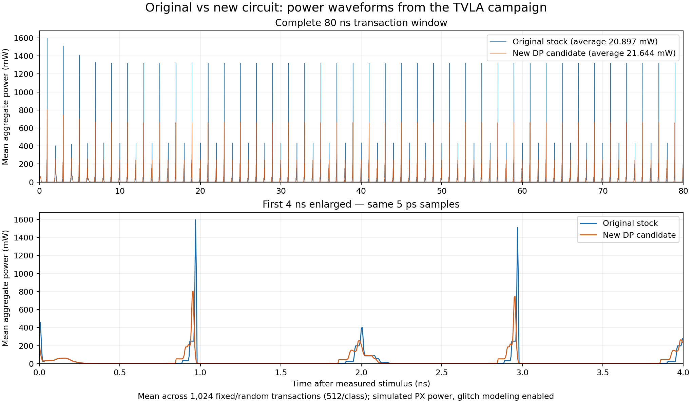

# Kairav_BTP_2026

## Security-Aware Clock Tree Synthesis through Weighted Data-Arrival Alignment

Bachelor thesis project by **Kairav Kumar**, under the supervision of **Prof. Chandan Karfa**.

This artifact accompanies a study of security-motivated clock-tree construction for masked hardware. It preserves the PRESENT experiment used in the paper: source-preserving static timing extraction, fixed secret/share priorities, LP clock scheduling, compatible sink grouping, and a cost-aware asymmetric tree constructor with a bounded DP frontier and mixed buffer strengths.

The evaluation circuit contains sixteen parallel copies of the unchanged masked PRESENT S-box RTL from the [TETRIS artifact](https://github.com/nilotpolas/TETRIS-artifact), assembled into a 64-bit substitution layer. Register and data-cell placement remain fixed for the reported comparison. TETRIS supplies the masked implementation; this project supplies clock-network optimization and evaluation.

## Recorded PRESENT results

- **16.42% lower weighted data-arrival spread**, using the original 8/4/2 marking policy.
- **23.73% lower aggregate modeled glitching power** over the full run.
- **3.57% total-power overhead** over the matched 80 ns measurement windows.
- **0.112% total cell-area overhead**.
- Full-sample FVR peak |t| **2.896 → 2.581**, with 512 traces per class and matched random/random controls.

These are the completed preserved measurements, not new simulations. The TVLA endpoint is a single matched seed campaign; prefix behavior and controls are retained in the assessment. Typical Nangate45 and placement-estimated parasitics are used. See [results](results/README.md) for averaging domains, accounting conventions and interpretation.



## Quick start

```bash
git clone https://github.com/KairavKumar/Kairav_BTP_2026.git
cd Kairav_BTP_2026
python3 -m venv .venv
. .venv/bin/activate
pip install -r requirements.txt
make verify
make summary
make figures
make tvla
make plan
```

Python 3.11+ is required. These commands verify the recorded artifact, regenerate plots, recompute full TVLA from compressed raw power, and run the shared-target LP without commercial tools. New outputs are written only to fresh directories under `runs/`. See [reproduction instructions](docs/REPRODUCTION.md) for native timing replay and physical reconstruction with the custom OpenROAD executable.

## Repository contents

- [`src/`](src): original experiment scripts, measured CTS source, RTL/provenance, and simulation recipes.
- [`results/present/`](results/present): stock, unrepaired and final physical circuits; planning inputs; exported lab inputs; four complete raw power outputs and derived results.
- [`verification/`](verification): original build commands, exact source-hash verification, imported-file manifest and native certification.
- [`paper/`](paper): latest supplied IEEE LaTeX draft, figures and Overleaf instructions. Suggested wording/citation edits remain separate from the author's draft.
- [`docs/`](docs): architecture, reproduction and commercial-tool setup.
- [`results/comparators/`](results/comparators): separately labeled exploratory tuned-Triton/iCTS study and its provenance correction.
- [`third_party/`](third_party): TETRIS/OpenROAD attribution and retained license notices.

## Quick start

```bash
python3 -m venv .venv
source .venv/bin/activate
pip install -r requirements.txt
make verify summary figures
make tvla
make plan
```

The first three targets verify preserved inputs, print results and regenerate plots. `make tvla` recomputes all four full campaigns from compressed raw power; `make plan` reruns the shared-group LP. Outputs use fresh directories under `runs/`; pass `--name` to the Python runner for repeated executions.




## Dependencies and execution levels

Offline analysis needs Python 3.11+ and NumPy, SciPy and Matplotlib. Native timing/construction additionally needs a compatible custom OpenROAD build. Fresh RTL synthesis needs Design Compiler (or a separately validated synthesis route); fresh simulation/power campaigns need licensed VCS and PrimeTime/PX, cell simulation models and a compiled library. These commercial installations and credentials are not distributed.

The measured build is identified by `verification/build/commands.json`; all 17 recorded source hashes match the bundled version. A historical copy of the constructor was recovered to avoid publishing later experiments as the measured implementation. A full clean dependency rebuild is distinct from replay with the preserved executable and is not claimed as validated.

## References and attribution

- N. Sarma, T. Patidar, N. Brahamanya and C. Karfa, **TETRIS: Automated Design Space Exploration of Randomness–Latency Trade-offs in Masked Hardware**. [Artifact](https://github.com/nilotpolas/TETRIS-artifact).
- A. Bogdanov et al., **PRESENT: An Ultra-Lightweight Block Cipher**, CHES 2007.
- [OpenROAD](https://github.com/The-OpenROAD-Project/OpenROAD) and [OpenSTA](https://github.com/The-OpenROAD-Project/OpenSTA).

Third-party components retain their own license notices. See [third_party/README.md](third_party/README.md). No credentials or commercial tool binaries are included.
